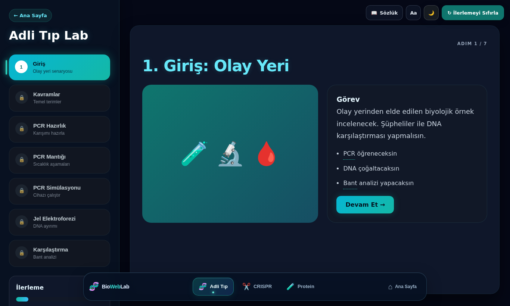
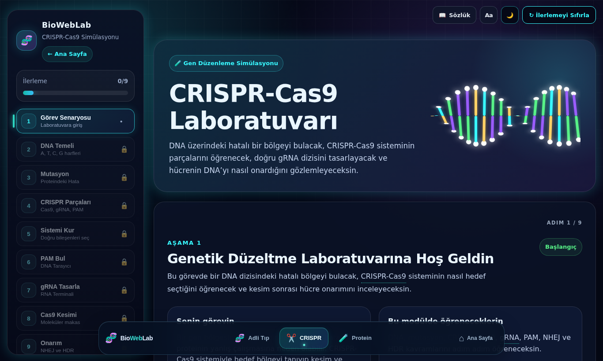
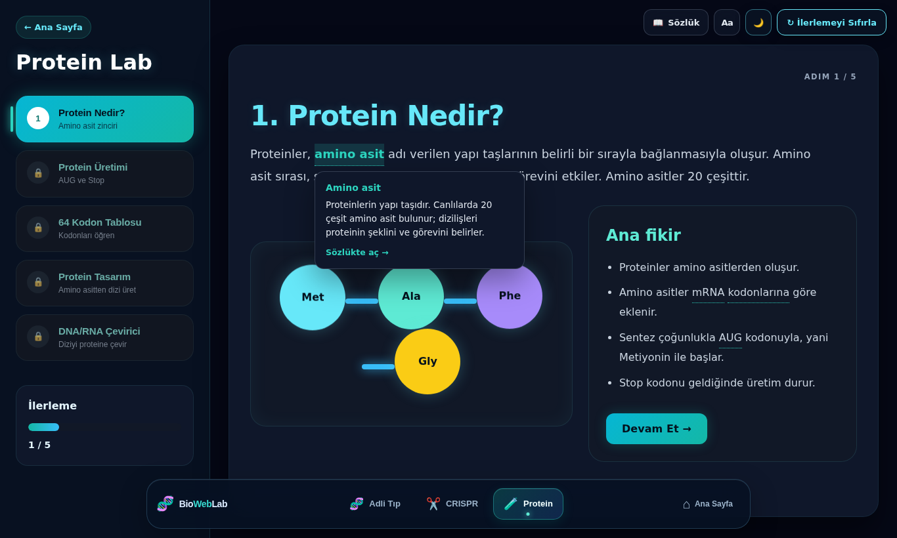
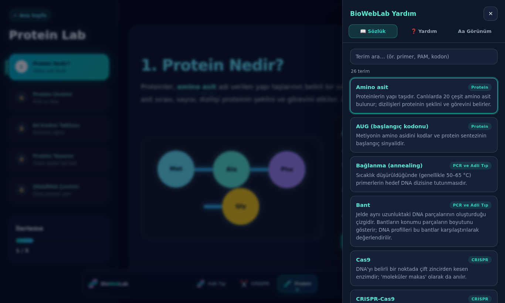

# 🧬 BioWebLab

**İnteraktif biyoteknoloji simülasyonları.** Biyoteknolojiyi ezberlemek yerine deneyerek öğrenmek için tasarlanmış, tarayıcıda çalışan sanal laboratuvar platformu. Kurulum, hesap veya sunucu gerektirmez.


## Modüller

| Modül | Adım | Kazanımlar |
|---|---|---|
| 🔬 **Adli Tıp Laboratuvarı** | 7 | PCR'ın üç sıcaklık aşamasını ve amacını açıklar · Jel elektroforezinde DNA bantlarını yorumlar · Şüpheli DNA profillerini bant analiziyle karşılaştırır |
| ✂️ **CRISPR Gen Düzenleme** | 9 | Mutasyonun proteini nasıl etkileyebileceğini kavrar · gRNA, PAM ve Cas9'un rolünü ilişkilendirir · NHEJ ve HDR onarım yollarını ayırt eder |
| 🧩 **Protein Tasarım Merkezi** | 5 | Amino asit zinciri ile protein ilişkisini açıklar · Kodon tablosuyla mRNA'yı proteine çevirir · DNA'dan RNA'ya baz eşleşmesini uygular |

Her modül sıralı adımlardan oluşur; bir adımın görevi tamamlanınca sıradaki adımın kilidi açılır.

<p>
  
  
</p>

## Kullanım kolaylığı ve erişilebilirlik

- **Dahili sözlük:** Metindeki noktalı çizgili terimlere (PCR, primer, PAM, kodon…) tıklayınca kısa açıklama açılır; tüm terimler aranabilir sözlükte listelenir.
- **Önceki adım ve adım göstergesi:** Her panelde "Adım 3 / 7" göstergesi ve "← Önceki adım" düğmesi bulunur.
- **Koyu / açık tema** ve sistem tercihine uyum.
- **Okunabilirlik ayarları:** Yazı boyutu (3 kademe), animasyonları azaltma, okuma modu. Tercihler tarayıcıda saklanır.
- **Klavye ile kullanım:** "İçeriğe geç" bağlantısı, görünür odak halkası, `?` ile yardım, `Esc` ile kapatma.
- **Mobil uyum:** Dar ekranlarda adım menüsü yatay kaydırılan şeride dönüşür.
- **Ana sayfada ilerleme:** Başladığın modülün kartında kaldığın yer görünür.

<p>
  
  
</p>

## Teknik yapı

Saf **HTML + CSS + JavaScript**; harici kütüphane veya derleme adımı yoktur.

```
index.html          Ana sayfa
style.css, main.js  Ana sayfa stilleri ve betiği
pages/
  adli-tip.*  crispr.*  protein.*   Modüllerin sayfa, stil ve betikleri
  modules-nav.*     Alt gezinme çubuğu
  theme.js          Tema yönetimi
  ui-polish.*       Ortak arayüz iyileştirmeleri
  ui-tools.*        Sözlük, yardım, erişilebilirlik ve adım gezinmesi
docs/screenshots/   README görselleri
```

## Yerelde çalıştırma

```bash
git clone https://github.com/Bedirhan7171/BioWebLab.git
cd BioWebLab
python3 -m http.server 8000   # ardından http://localhost:8000
```

`index.html` dosyasını doğrudan tarayıcıda açmak da yeterlidir.

## Notlar

- Modül ilerlemesi yalnızca oturum boyunca saklanır; sayfa yenilenince başa dönülür. Görünüm tercihleri (tema, yazı boyutu) kalıcıdır.
- Font olarak Google Fonts üzerinden Inter kullanılır; çevrimdışıyken sistem fontuna geçer.
