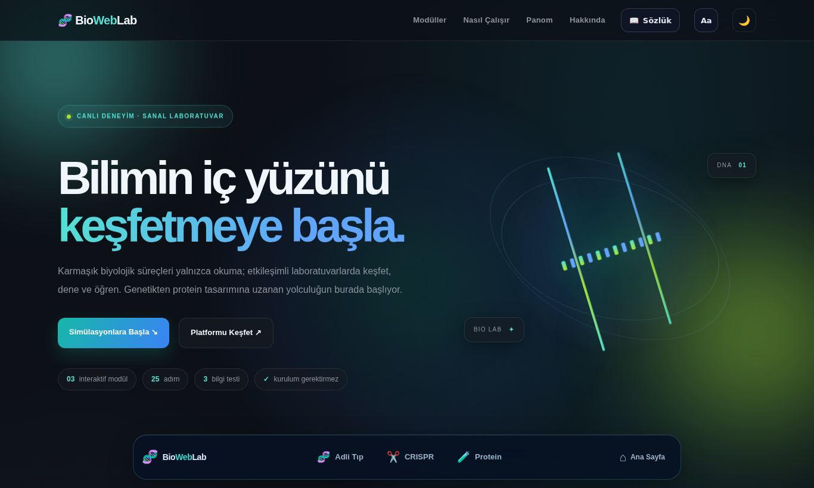
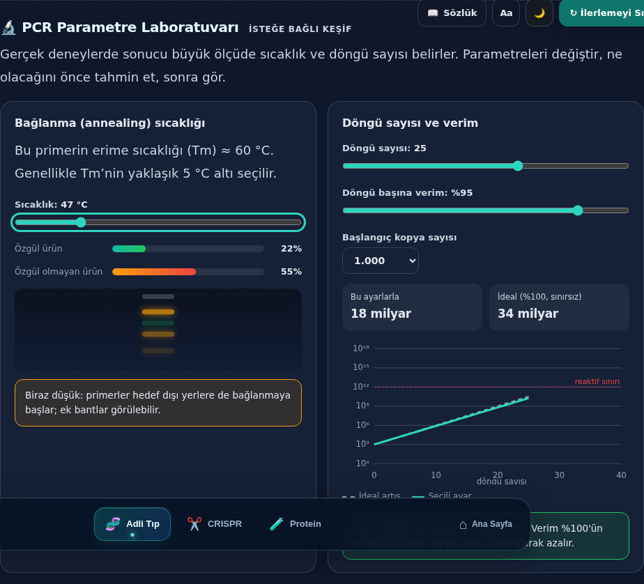
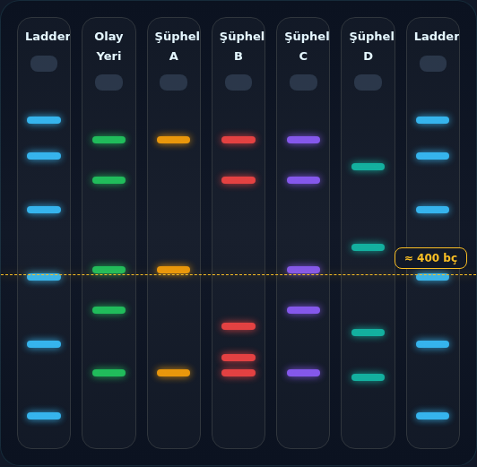
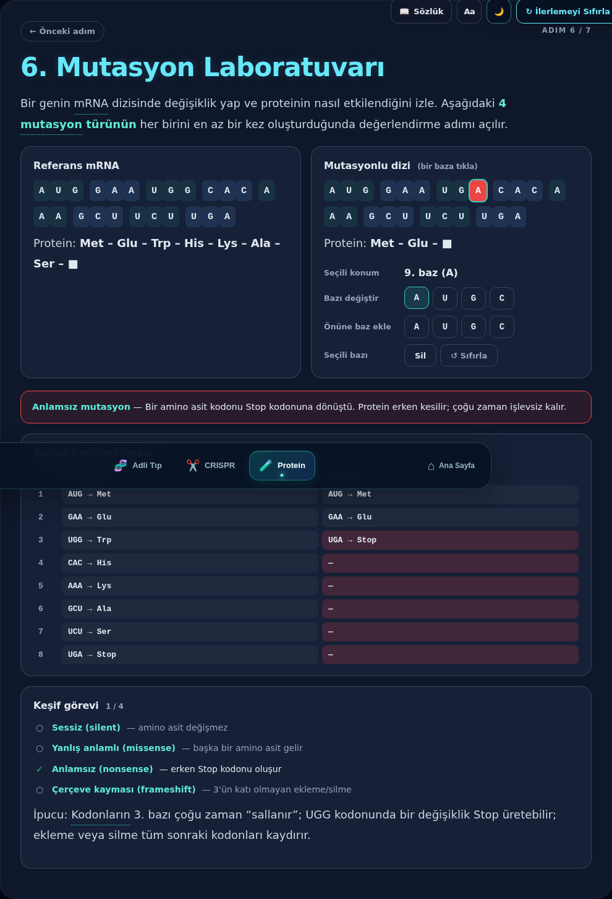
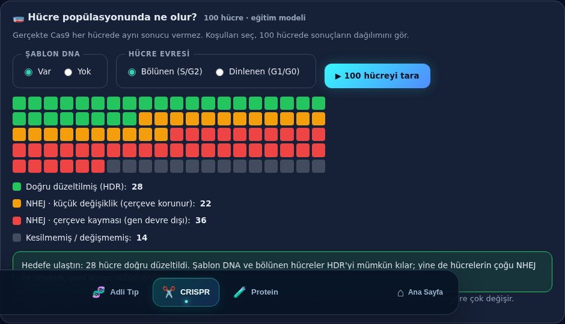
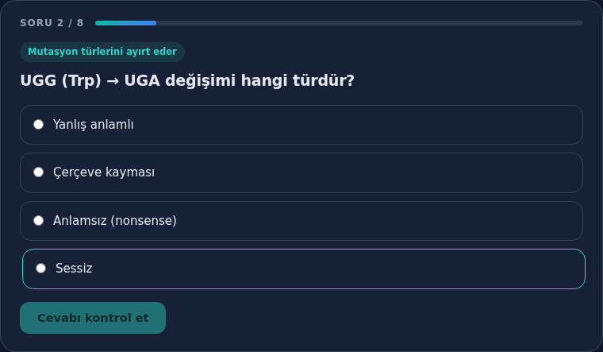
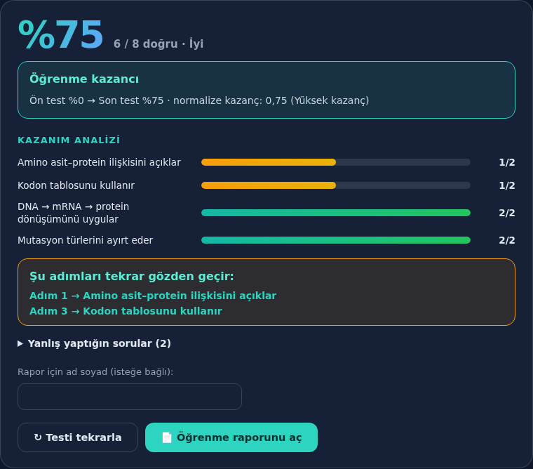
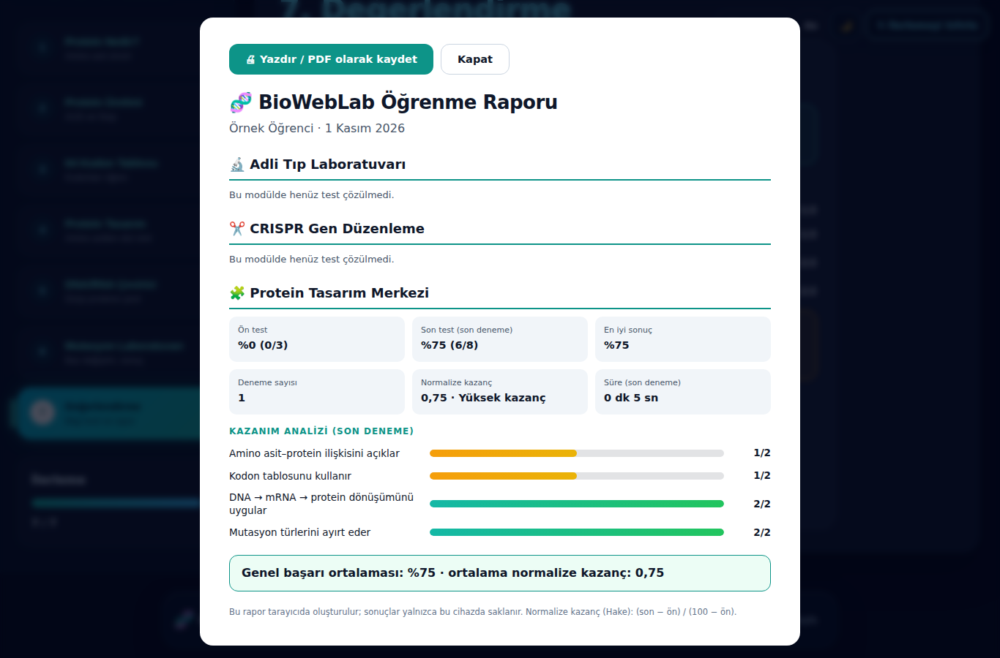
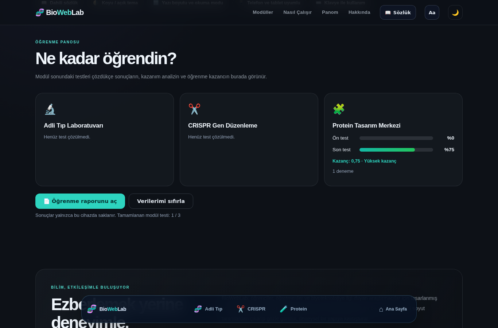
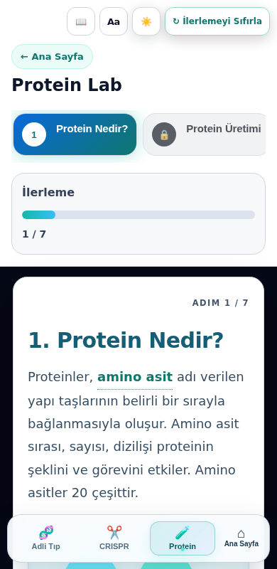

# 🧬 BioWebLab

**İnteraktif biyoteknoloji simülasyonları.** Biyoteknolojiyi ezberlemek yerine deneyerek öğrenmek için tasarlanmış, tarayıcıda çalışan sanal laboratuvar platformu. Kurulum, hesap veya sunucu gerektirmez.



## Modüller

| Modül | Adım | Kazanımlar |
|---|---|---|
| 🔬 **Adli Tıp Laboratuvarı** | 8 | PCR bileşenlerini ve işlevlerini açıklar · PCR döngüsünü ve DNA çoğalmasını açıklar · Jel elektroforezinde bantları yorumlar · Adli DNA bulgusunu eleştirel değerlendirir |
| ✂️ **CRISPR Gen Düzenleme** | 10 | Mutasyonun protein üzerindeki etkisini açıklar · CRISPR bileşenlerinin rolünü ilişkilendirir · NHEJ / HDR sonuçlarını karşılaştırır |
| 🧩 **Protein Tasarım Merkezi** | 7 | Amino asit–protein ilişkisini açıklar · Kodon tablosunu kullanır · DNA → mRNA → protein dönüşümünü uygular · Mutasyon türlerini ayırt eder |

Her modül sıralı adımlardan oluşur; bir adımın görevi tamamlanınca sıradaki adımın kilidi açılır. Her modülün son adımı bir **bilgi testidir**.

<p>
  
  
</p>

## Öğrenme mekanikleri

- **PCR parametre laboratuvarı:** Bağlanma (annealing) sıcaklığını değiştirerek özgül / özgül olmayan ürün oranını, döngü sayısı ve verimle kopya sayısındaki üstel artışı (reaktif sınırındaki platoyla birlikte) logaritmik grafikte gözlemle.
- **Her seferinde değişen adli vaka:** Olay yeri ve 4 şüpheli profili rastgele üretilir (tam eşleşme, “yakın ama farklı”, yetersiz ve farklı profil). Jel üzerindeki **cetvel**, ladder’a göre bant boyutunu kestirir (yarı-logaritmik). “Yeni vaka” ile tekrar denenebilir.
- **Hataya özel geri bildirim:** PCR karışımında hangi bileşenin neden yanlış ya da eksik olduğu açıklanır.
- **Mutasyon laboratuvarı:** mRNA üzerinde baz değiştir, ekle veya sil; sistem sonucu *sessiz, yanlış anlamlı, anlamsız, çerçeve kayması* olarak sınıflandırır ve kodon kodon karşılaştırır. Dört türün hepsini keşfedince değerlendirme açılır.
- **DNA/RNA çevirici:** Kalıp zinciri (3′→5′), kodlayan zincir (5′→3′) ve mRNA girişleri; ribozom gibi ilk AUG’yi tarar, öncesini 5′ UTR olarak ayırır.
- **Hücre popülasyonu simülasyonu (CRISPR):** Şablon DNA ve hücre evresine göre 100 hücrede HDR / NHEJ sonuçlarının rastgele dağılımı. Onarım “kusursuz” değil, olasılıksal olarak gösterilir.

<p>
  
  
</p>

## Ölçme ve değerlendirme

- **Ön test (3 soru, isteğe bağlı)** her modülün 1. adımında yer alır; doğru cevaplar gösterilmez.
- **Son test (8 soru)** her denemede 14–15 soruluk bankadan kazanımlara dengeli dağıtılarak seçilir; soru ve seçenek sırası değişir. Türler: çoktan seçmeli, sıralama, kısa yanıt. Her sorudan sonra açıklama gösterilir.
- **Kazanım bazlı analiz:** %70 altındaki kazanımlar için ilgili adıma dönüş bağlantıları önerilir.
- **Normalize öğrenme kazancı (Hake):** (son − ön) / (100 − ön).
- **Öğrenme Panosu ve yazdırılabilir rapor:** Ana sayfada modül bazlı sonuçlar; rapor tek sayfa PDF olarak kaydedilebilir.
- Sonuçlar yalnızca kullanıcının cihazında (`localStorage`) saklanır; hiçbir veri sunucuya gönderilmez.
- Sorular `pages/questions.js` dosyasında tutulur; öğretmenler yeni soru ekleyebilir.

<p>
  
  
  
</p>



## Kullanım kolaylığı ve erişilebilirlik

- **Dahili sözlük:** Metindeki noktalı çizgili terimlere tıklayınca kısa açıklama açılır; 33 terim aranabilir sözlükte listelenir.
- **Önceki adım ve adım göstergesi** her panelde bulunur.
- **Koyu / açık tema** ve sistem tercihine uyum.
- **Okunabilirlik ayarları:** Yazı boyutu (3 kademe), animasyonları azaltma, okuma modu. Tercihler saklanır.
- **Klavye ile kullanım:** “İçeriğe geç” bağlantısı, görünür odak halkası, `?` ile yardım, `Esc` ile kapatma.
- **Mobil uyum:** Dar ekranlarda adım menüsü yatay kaydırılan şeride dönüşür.



## Eğitim modeli notları

Simülasyonlar öğrenmeyi kolaylaştırmak için sadeleştirilmiştir: rehber RNA gerçekte ~20 nükleotit uzunluğundadır; bu modelde kısaltılmış dizi kullanılır. Simülasyondaki olasılıklar (örn. HDR/NHEJ oranları) eğitim amaçlı yuvarlatılmış örnek değerlerdir; gerçek verim hücre tipine, kılavuz RNA’ya ve yönteme göre çok değişir. Jel modeli yarı-logaritmik ladder yaklaşımını kullanır.

## Teknik yapı

Saf **HTML + CSS + JavaScript**; harici kütüphane veya derleme adımı yoktur.

```
index.html          Ana sayfa (kartlar, nasıl çalışır, öğrenme panosu)
style.css, main.js  Ana sayfa stilleri ve betiği
pages/
  adli-tip.*  crispr.*  protein.*     Modüllerin sayfa, stil ve betikleri
  adli-extras.js  crispr-extras.js  protein-mutlab.js   Ek mekanikler
  questions.js      Soru bankası (kazanım etiketli)
  assessment.*      Ölçme-değerlendirme motoru, rapor, pano
  ui-tools.*        Sözlük, yardım, erişilebilirlik, adım gezinmesi
  ui-polish.*       Ortak arayüz iyileştirmeleri
  mechanics.css     Yeni mekaniklerin stilleri
  modules-nav.*  theme.js
docs/screenshots/   README görselleri
```

## Yerelde çalıştırma

```bash
git clone https://github.com/Bedirhan7171/BioWebLab.git
cd BioWebLab
python3 -m http.server 8000   # ardından http://localhost:8000
```

`index.html` dosyasını doğrudan tarayıcıda açmak da yeterlidir.

## Notlar

- Modül ilerlemesi yalnızca oturum boyunca saklanır; sayfa yenilenince başa dönülür. Test sonuçları ve görünüm tercihleri kalıcıdır.
- Font olarak Google Fonts üzerinden Inter kullanılır; çevrimdışıyken sistem fontuna geçer.
